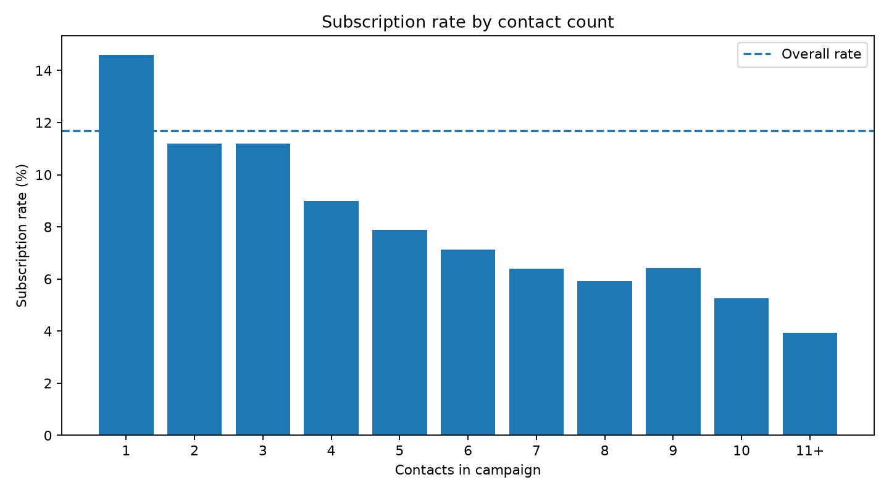
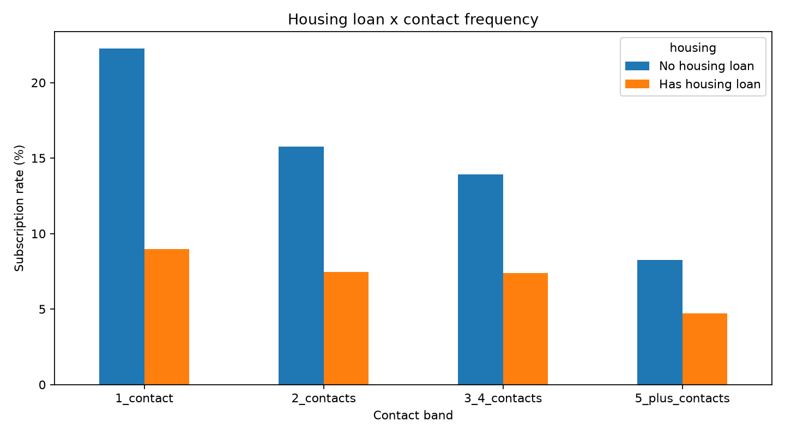
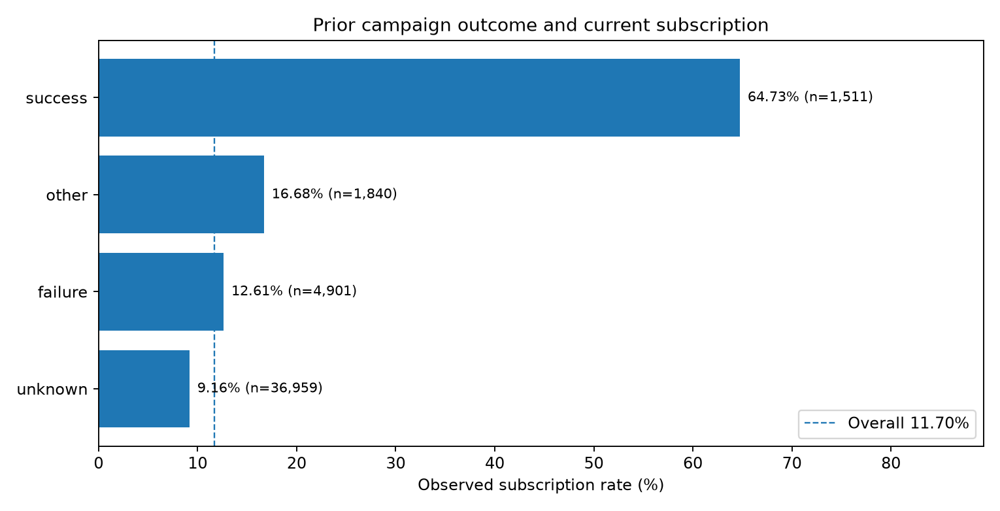
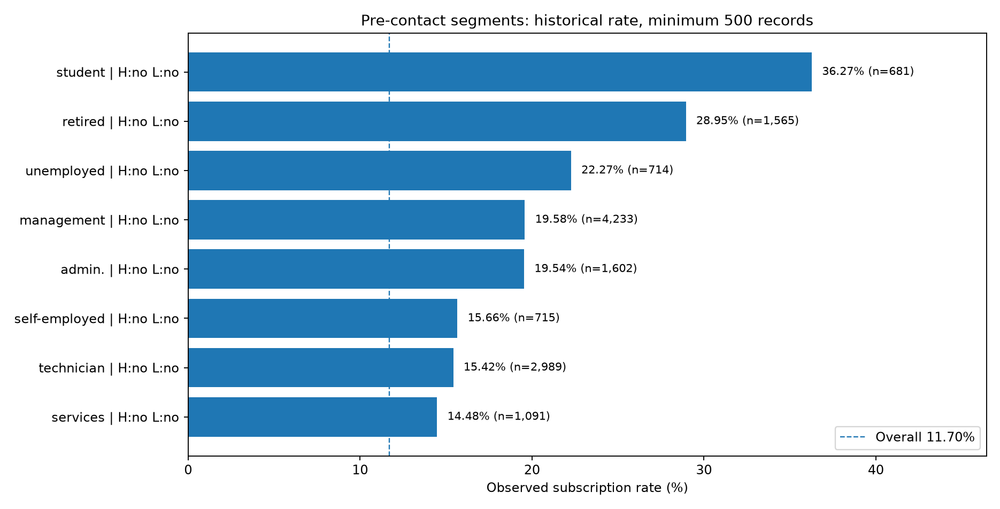
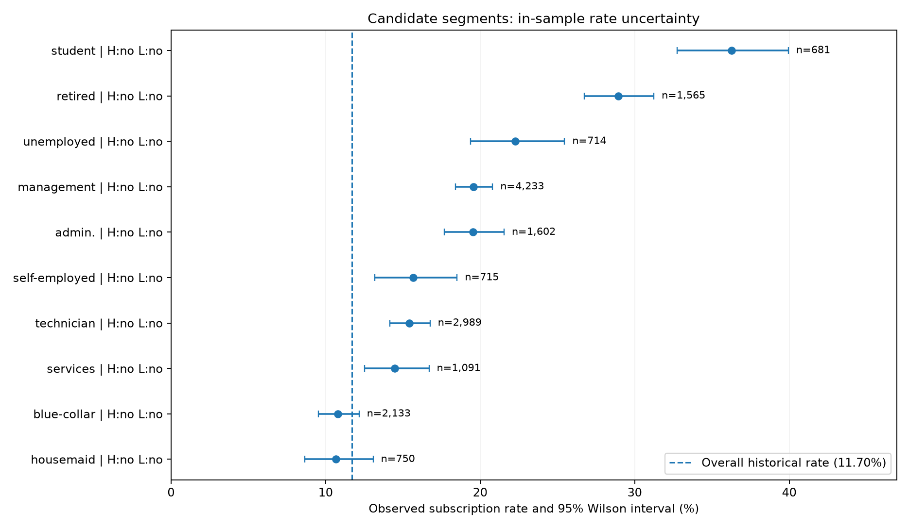

# Bank Marketing — Conversion and Customer Segmentation Analysis

Historical descriptive analysis of telephone-based term-deposit marketing outcomes, using **MySQL**, **Python**, and **Wilson confidence intervals**. The aim is to locate meaningful associations, compare segment efficiency with scale, and propose a rigorous path for validating future outreach decisions. **This project does not estimate causal treatment effects or actual incremental profit.**

## Data

- **Source:** [UCI Bank Marketing](https://archive.ics.uci.edu/dataset/222/bank+marketing), legacy `bank-full.csv` version ([DOI](https://doi.org/10.24432/C5K306)). The dataset is attributed to S. Moro, P. Cortez and P. Rita.
- **Scope:** 45,211 historical marketing observations; 17 source columns; 5,289 successful subscriptions (`y=yes`), for an **11.70% observation-level subscription rate**.
- **Grain:** one marketing observation per row, not necessarily one distinct customer. No durable customer identifier is present. `record_id` is a synthetic row key created solely for SQL import.
- **Raw data:** not committed. Download UCI's `bank.zip`, extract `bank-full.csv`, and place it under `data/`.

## Analysis approach

1. Audit missing values, empty strings, duplicates, unusual values, and categorical `unknown` values.
2. Create a typed MySQL table and reconcile SQL aggregates to Python totals.
3. Segment outcomes by occupation, housing/personal loan attributes, and prior campaign outcome.
4. Examine contact-frequency bands and within-housing comparisons using CTEs and window functions.
5. Compare group conversion rates, historical subscription counts and **descriptive Lift** relative to the full sample.
6. Compute Wilson 95% intervals for ten shortlisted groups as a measure of sampling uncertainty; document interpretation and validity limitations.

## Selected findings

| Measure | Historical observation |
|---|---:|
| Overall subscription rate | **11.70%** (5,289 / 45,211) |
| One contact | **14.60%** |
| Eleven or more contacts | **3.93%** |
| Prior campaign outcome = `success` | **64.73%** (978 / 1,511) |
| Student, no housing/personal loan | **36.27%** (247 / 681) |
| Management, no housing/personal loan | **19.58%**, with 829 observed subscriptions (829 / 4,233) |

Among the ten shortlisted segments, **16,473** historical observations account for **3,042** subscriptions. The top-ranked student/no-loan group has a Wilson 95% interval of **[32.75%, 39.95%]** under an independent Bernoulli approximation. Note that the shortlist was selected from the same data; it is **not** an out-of-sample assessment.

## Visual summaries

**Contact frequency (descriptive, not causal)**



**Housing-loan status × contact-frequency bands**



**Previous campaign outcomes**



**Observed rates by pre-contact attributes**



**Wilson confidence intervals for shortlisted groups**



## Files

| Path | Purpose |
|---|---|
| `01_data_audit.py` | Initial quality checks and descriptive metrics |
| `02_prepare_mysql_import.py` | Convert semicolon-delimited CSV; create synthetic `record_id` |
| `03_import_bank_to_mysql.py` | Insert data into local MySQL and reconcile totals |
| `04_export_sql_results.py` | Read-only export of campaign-frequency result sets |
| `05_visualize_segments.py` | Contact and housing-loan plots |
| `06_export_customer_strategy.py` | Read-only export of prior-outcome and customer segments |
| `07_customer_priority_analysis.py` | Screen and plot descriptive candidate groups |
| `08_segment_robustness.py` | Wilson interval calculations and validation report |
| `sql/` | Schema, aggregate queries, CTEs, window rankings, segment screening |
| `outputs/` | Shareable aggregate CSVs, plots and analytical reports |

## Reproduce

Python 3.10+ and MySQL 8+ are recommended. Use a local MySQL instance; the Python connection scripts prompt for credentials interactively and **do not store passwords in the repository**.

```bash
python -m pip install -r requirements.txt
python 01_data_audit.py
python 02_prepare_mysql_import.py
```

Run `sql/01_create_database.sql` in MySQL Workbench to create `bank_marketing_project.bank_marketing`, then import `data/bank_mysql_import.csv` via:

```bash
python 03_import_bank_to_mysql.py
```

Confirm 45,211 observations and 5,289 subscriptions in SQL. Run the SQL scripts in `sql/` for full exploratory queries. Then:

```bash
python 04_export_sql_results.py
python 05_visualize_segments.py
python 06_export_customer_strategy.py
python 07_customer_priority_analysis.py
python 08_segment_robustness.py
```

SQL scripts and read-only exports are separated intentionally. The `outputs/` directory contains **aggregate** artifacts. The `data/` directory is excluded from version control.

## Interpretation and limitations

- **Associations, not effects:** More contacts may occur precisely because a customer is difficult to convert; observed conversion rates do not identify the effect of another call.
- **Timing / leakage:** `duration` and the final `campaign` count are not available at the initial contact decision. Any previous-outcome field may be used for targeting only if it was known at the time of that decision.
- **Missing identifiers and inputs:** No unique customer IDs, full campaign chronology, per-contact costs, product margins or randomized control arm are supplied. Customer-level response, incremental uplift, revenue and ROI are **not** estimated.
- **Statistical limits:** Wilson intervals assume independent Bernoulli observations; repeat exposure, retrospective segment selection, multiple testing, and confounding can affect uncertainty or generalization.
- **Operational validation:** A prospective, compliant customer-level randomized policy test would be needed to estimate incremental outcomes, with opt-out, complaint and customer-experience guardrails and a prespecified analysis plan. Historical differences alone do not justify excluding groups from financial services.

## Data attribution

UCI Machine Learning Repository, *Bank Marketing* dataset. Original research: Moro, Cortez, and Rita (2014), *A Data-Driven Approach to Predict the Success of Bank Telemarketing*. Check the UCI dataset page for applicable terms and attribution details.
